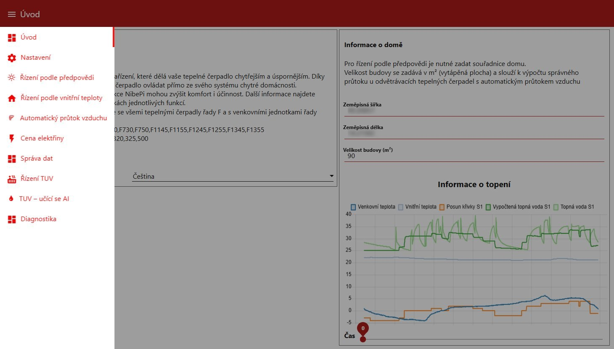
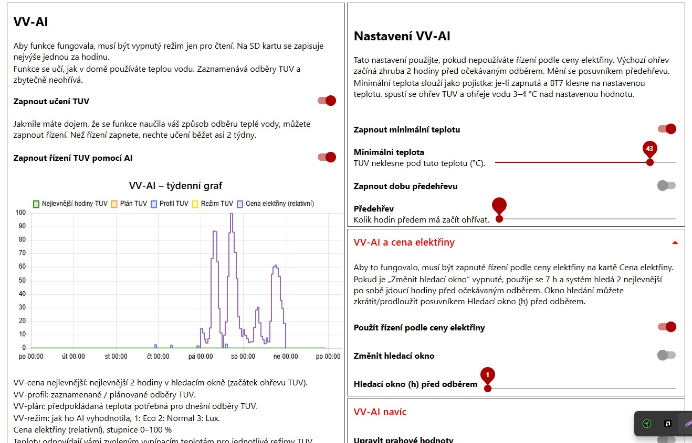
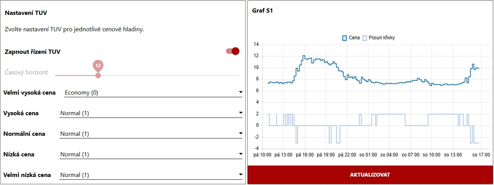
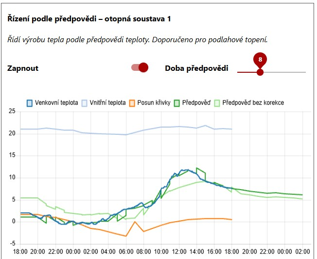
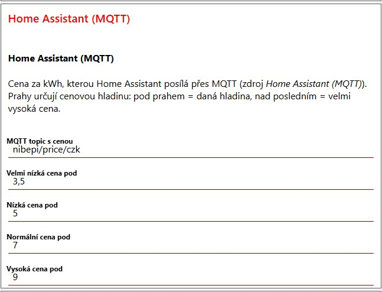
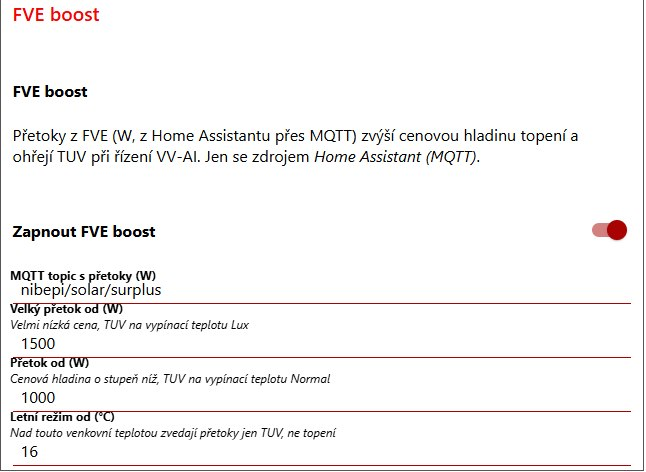

# nibepi-cz

NibePi, a Node-RED controller for Nibe F-series heat pumps, packaged for Docker
and adapted for the Czech Republic and an RS485 HAT on a Raspberry Pi.
Everything is in one repository: the core, the Node-RED nodes, the flows and
the Docker image.

🇨🇿 **Česky:** [README.md](README.md)

> [!NOTE]
> **This project is still under development.** It runs daily on a real heat pump
> (VVM320), but features are still being tuned and may change. Feedback, bug
> reports and ideas for improvements are welcome – please open an
> [issue](https://github.com/Samot89/nibepi-cz/issues) or send a pull request.

## Dashboard screenshots

The dashboard is shown in Czech.

| | |
|---|---|
|  Home |  VV-AI hot water learning |
|  Electricity price and hot water settings |  Forecast control |
|  Price from Home Assistant |  PV boost |

## Lineage

| | |
|---|---|
| [anerdins](https://github.com/anerdins) | original NibePi (up to 1.2.1) |
| [fnordpojk](https://github.com/fnordpojk) | NibePi 2.0: Docker image, Node-RED 5 / Node 24, work from ahsberg and pizzihelmet (VV-AI, pool) |
| this repository | changes below |

The full history of all upstream repositories is kept (merged with
`git subtree`). None of the upstream authors are involved in this fork.

| directory | upstream |
|---|---|
| `nibepi/` | [fnordpojk/nibepi-backend](https://github.com/fnordpojk/nibepi-backend) ← [anerdins/nibepi](https://github.com/anerdins/nibepi) — the core: protocol, register handling, MQTT |
| `node-red-contrib-nibepi/` | [fnordpojk/node-red-contrib-nibepi](https://github.com/fnordpojk/node-red-contrib-nibepi) ← [anerdins/node-red-contrib-nibepi](https://github.com/anerdins/node-red-contrib-nibepi) — the Node-RED nodes and dashboard logic |
| `flows/` | [fnordpojk/nibepi-flow](https://github.com/fnordpojk/nibepi-flow) ← [anerdins/nibepi-flow](https://github.com/anerdins/nibepi-flow) — the flows, bind-mounted as `/data` |
| root | [fnordpojk/nibepi-docker](https://github.com/fnordpojk/nibepi-docker) — Dockerfile |

## What this fork adds

- **RS485 HAT in Docker.** The upstream image targets a NibeGW gateway over UDP
  and does not install the core's own dependencies, so `serialport` was missing
  and `connection.enable: "serial"` could not work. The Dockerfile now installs
  them; the container gets `/dev/ttyAMA0`.
- **Price from Home Assistant (`price.source: "mqtt_ha"`).** The built-in price
  sources (Tibber, elprisetjustnu.se) only cover the Nordics. This one takes the
  current price in CZK/kWh from MQTT, published by Home Assistant, with your own
  thresholds for the five price levels. Selectable in the dashboard.
- **PV surplus boost.** A PV export reading on MQTT raises the price level
  (≥ 1500 W → VERY_CHEAP, ≥ 1000 W → one step up, both adjustable). Above 16 °C outdoors only hot
  water is boosted, not heating.
- **VV-AI (hot water learning) with Home Assistant prices.** An hourly price list
  for today and tomorrow from HA lets VV-AI plan hot water into the cheapest hours;
  PV surplus heats hot water to the Normal/Lux stop temperature.
- **Open-Meteo forecast.** SMHI only covers Scandinavia; forecast control now
  uses Open-Meteo.
- **Czech dashboard** (Settings → Language → Čeština).
- Fixes: room sensors fed by HA `mqtt_statestream` (`homeassistant/sensor/<entity>/state`)
  were dropped by the core; switching VV-AI control off left the pump's hot water
  period at 0, so no hot water was made.

## Quick start (Raspberry Pi with RS485 HAT)

Verified on a Pi Zero 2 W with 64-bit Raspberry Pi OS Lite (Debian 13).

1. **Wiring.** With the pump switched off at the breaker, connect the HAT to the pump
   (12 V, A, B, GND differ between models) following
   [Nibe's documentation](https://www.nibe.fi/nibedocuments/15050/031725-6.pdf) and
   your HAT's documentation.
2. **Modbus in the pump.** Hold **Back** for about 7 seconds, open **5.2 System
   settings** and tick **Modbus**. A red alarm may show until NibePi answers.
3. **Install.** The script installs Docker, enables the UART, builds the image and
   then asks for the broker, home location, pump model and room sensor:

   ```sh
   git clone https://github.com/Samot89/nibepi-cz.git
   cd nibepi-cz
   ./scripts/setup_pi.sh
   sudo reboot
   /opt/nibepi/src/nibepi-cz/scripts/run_nibepi.sh
   ```

4. Open `http://<pi>:1880/ui`.
5. **Home Assistant.** Follow the
   [automation guide](examples/home-assistant/README.en.md).

⚠️ **Node-RED on port 1880 has no password.** Anyone who reaches it can change the
pump's settings, so do not forward the port to the internet; use a VPN instead.

- `scripts/configure.sh` runs the setup questions again.
- `scripts/run_nibepi_test.sh` runs NibePi without the pump, next to an existing
  NibePi, without touching its Home Assistant entities.

Update:

```sh
cd /opt/nibepi/src/nibepi-cz && git pull
sudo docker build -t nibepi-nodered . && ./scripts/run_nibepi.sh
```

### Price from Home Assistant and PV boost settings

Everything is set in the dashboard, tab **Price**:

- **Datasource** → *Home Assistant (MQTT)*
- group **Home Assistant (MQTT)**: MQTT topic of the price and the four level limits
- group **PV boost**: on/off, MQTT topic of the PV surplus (W), the two surplus
  limits (W) and the outdoor temperature above which only hot water is boosted

In `config.json` these are `price.mqtt_ha_topic`, `mqtt_ha_vc`, `mqtt_ha_c`,
`mqtt_ha_n`, `mqtt_ha_e`, `solar_enable`, `solar_topic`, `solar_high`, `solar_low`
and `solar_summer_temp`. Older configs with `mqtt_ha_thresholds` /
`solar_thresholds` are taken over as the starting values.

```json
"connection": { "enable": "serial", "series": "fSeries" },
"serial": { "port": "/dev/ttyAMA0" },
"price": {
  "enable": true,
  "source": "mqtt_ha",
  "mqtt_ha_topic": "nibepi/price/czk",
  "mqtt_ha_vc": 3.5, "mqtt_ha_c": 5, "mqtt_ha_n": 7, "mqtt_ha_e": 9,
  "solar_enable": true,
  "solar_topic": "nibepi/solar/surplus",
  "solar_high": 1500, "solar_low": 1000, "solar_summer_temp": 16
}
```

Prices are compared with `<`: below `mqtt_ha_vc` is VERY_CHEAP, below `mqtt_ha_e`
is EXPENSIVE, anything higher is VERY_EXPENSIVE. The curve offset for each level
comes from the usual `heat_*_s1` settings. Retained values on
`nibepi/price/thresholds/*` override the configured limits.

With VV-AI control on, PV surplus also heats hot water: from `solar_low` to the
Normal stop temperature, from `solar_high` to the higher of Lux/Normal. A boost
starts only when BT7 is at least 2 °C below the target, then runs to the target and
stops early only after 10 minutes of surplus below `solar_low` (no short compressor
cycles on a fluctuating surplus).

Edit `config.json` by hand only with the container stopped, as NibePi writes its
in-memory config back.

### VV-AI control and the hot water period

With VV-AI control on, NibePi holds the pump's hot water period (register 47134)
at 0 and starts hot water itself (48132). While the Pi is off, VV-AI starts no
heating; the pump may still heat by its own temperatures, so check this during a longer
outage. Switching VV-AI control off restores the saved period
(`hotwater.vv_backup_hw_period`).

---

The rest of this file is the upstream documentation.

## Building

```sh
docker build -t nibepi-nodered .
```

The image installs the two packages from the local directories rather than from
git, so an edit in either directory shows up in the next build without committing
anything. That is deliberate: it is the loop for testing against a real pump.

## Running

With an RS485 HAT, use `scripts/run_nibepi.sh`. With a NibeGW gateway:

```sh
docker run -dit --name nibepi --restart unless-stopped \
  -v /opt/nibepi/src/nibepi-cz/flows:/data \
  -v /opt/nibepi/etc/nibepi:/etc/nibepi \
  -v /opt/nibepi/tmp:/tmp \
  -p 1880:1880 \
  -p 9999:9999/udp \
  nibepi-nodered
```

A fixed name means the same command will not simply run again after a
rebuild. Replace the container with:

```sh
docker stop nibepi && docker rm nibepi
```

| mount | holds |
|---|---|
| `/data` | Node-RED's own directory: `flows.json`, `settings.js`, installed nodes. The `flows/` directory of this repository; Node-RED rewrites `flows.json` when you edit the dashboard. |
| `/etc/nibepi` | NibePi's state: `config.json`, saved graphs, the VV-AI profile. Must persist and must be writable. |
| `/tmp` | `nibepi.log`, the debug log. Mount it only if you want to read the log from the host. |

| port | for |
|---|---|
| `1880/tcp` | the Node-RED editor and dashboard |
| `9999/udp` | inbound frames from the NibeGW gateway |

Outbound, NibePi sends read requests to the gateway on UDP **10000** and writes
on UDP **10001**, from source port 9999. Those need no published port, but the
gateway has to accept them. With
[elupus/esphome-nibe](https://github.com/elupus/esphome-nibe) that means the
Docker host's address must appear in the `source:` list, and `read_port` /
`write_port` must be `10000` / `10001` to match.

## NIBEPI_DOCKER

The image sets `NIBEPI_DOCKER=1`. Without it the core assumes a bare Raspberry Pi
with a read-only SD card and brackets every config write in
`sudo mount -o remount,rw /`, which fails inside a container and loses the write
silently. Bare-Pi installs leave the variable unset.

## Pulling upstream changes

```sh
git subtree pull --prefix=nibepi https://github.com/fnordpojk/nibepi-backend.git master
git subtree pull --prefix=node-red-contrib-nibepi https://github.com/fnordpojk/node-red-contrib-nibepi.git master
git subtree pull --prefix=flows https://github.com/fnordpojk/nibepi-flow.git master
```

## ☕ Support

If you like this project and it helped you, you can buy me a coffee:

[](https://paypal.me/sulc89)

Thank you! Donations are voluntary, the project stays free.

## License

MIT, see [LICENSE](LICENSE). Based on [NibePi](https://github.com/anerdins/nibepi) by anerdins (MIT); the original license files are kept in `nibepi/`, `node-red-contrib-nibepi/` and `flows/`.
