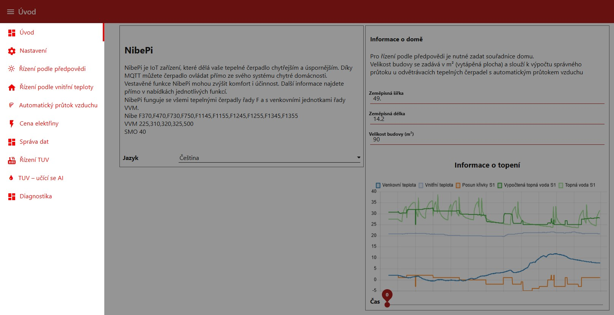
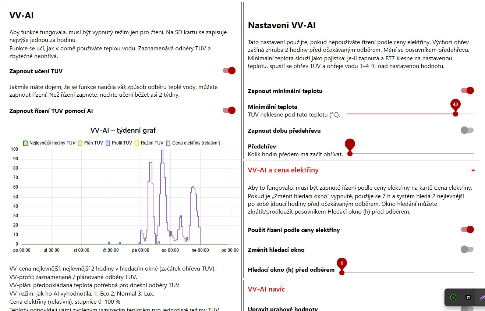
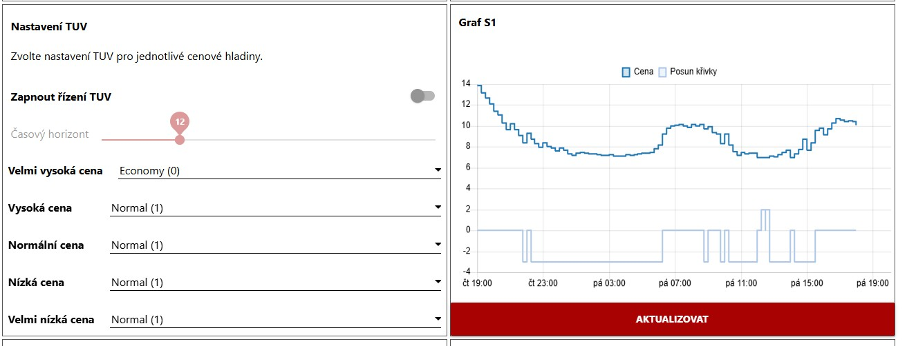
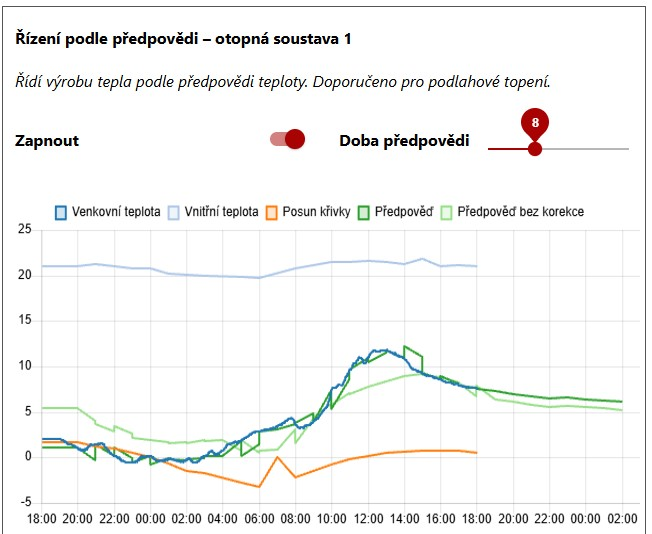
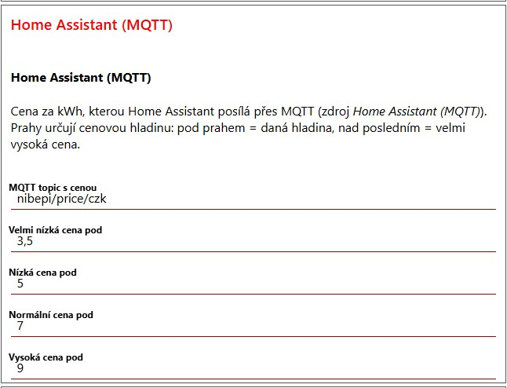
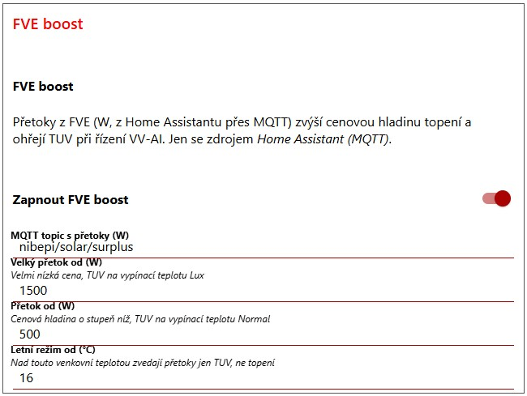

# NibePi v Dockeru – česká verze

Řízení tepelných čerpadel Nibe řady F (např. VVM320, F1255) z Raspberry Pi
přes RS485 HAT, s cenami elektřiny a FVE přetoky z Home Assistantu.
Vše v jednom repozitáři: jádro, Node-RED nody, flows i Docker image.

🇬🇧 English: [README.en.md](README.en.md)

## Ukázky dashboardu

| | |
|---|---|
|  Úvod |  TUV – učící se AI |
|  Cena elektřiny a nastavení TUV |  Řízení podle předpovědi |
|  Cena z Home Assistantu |  FVE boost |

## Odkud to je

| | |
|---|---|
| [anerdins](https://github.com/anerdins) | původní NibePi (do verze 1.2.1) |
| [fnordpojk](https://github.com/fnordpojk) | NibePi 2.0: Docker, Node-RED 5 / Node 24, práce od ahsberg a pizzihelmet (VV-AI, bazén) |
| tento repozitář | úpravy pro ČR (níže) |

Celá historie všech původních repozitářů je zachovaná. Původní autoři se na tomto
forku nepodílejí, chyby proto prosím nehlaste u nich.

| složka | obsah |
|---|---|
| `nibepi/` | jádro: komunikace s čerpadlem, registry, MQTT |
| `node-red-contrib-nibepi/` | Node-RED nody: ceny, počasí, TUV, VV-AI |
| `flows/` | Node-RED flows a dashboard (připojí se do kontejneru jako `/data`) |
| `scripts/`, `examples/` | instalace na Pi, spuštění, vzorový config, Home Assistant |

## Co tento fork přidává

- **RS485 HAT v Dockeru.** Původní image počítá s bránou NibeGW přes UDP a
  neinstaluje závislosti jádra, takže chyběl `serialport` a připojení přes
  sériový port (`connection.enable: "serial"`) nefungovalo.
- **Cena z Home Assistantu (`price.source: "mqtt_ha"`).** Vestavěné zdroje cen
  (Tibber, elprisetjustnu.se) jsou jen pro severské země. Tenhle bere aktuální
  cenu v Kč/kWh z MQTT, kam ji posílá Home Assistant, a podle vašich prahů z ní
  určí jednu z pěti cenových hladin. Dá se zvolit i v dashboardu.
- **FVE boost.** Přetoky z FVE posílané přes MQTT zvednou cenovou hladinu
  (≥ 1500 W → VERY_CHEAP, ≥ 500 W → o stupeň výš). Nad 16 °C venku se boostuje
  jen ohřev TUV, ne topení.
- **VV-AI (učení TUV) s cenami z Home Assistantu.** Hodinový ceník na dnešek a
  zítřek z HA umožní VV-AI plánovat ohřev TUV do nejlevnějších hodin. FVE přetoky
  ohřejí TUV na vypínací teplotu Normal/Lux.
- **Předpověď z Open-Meteo.** SMHI pokrývá jen Skandinávii, prognózní regulace
  proto bere předpověď z Open-Meteo.
- **Čeština v dashboardu.**
- Opravy: pokojová čidla z HA `mqtt_statestream` (`homeassistant/sensor/<entita>/state`)
  jádro zahazovalo; po vypnutí řízení VV-AI zůstala perioda TUV v čerpadle na 0
  a TUV se neohřívala.

## Co je potřeba

- Raspberry Pi (ověřeno na **Pi Zero 2 W**, stačí 512 MB RAM) s 64bit
  Raspberry Pi OS Lite (Debian 12 nebo 13)
- RS485 HAT na GPIO (UART na pinech 14/15), zapojený do čerpadla
- MQTT broker (např. Mosquitto add-on v Home Assistantu)

## Instalace

1. Naflashujte Raspberry Pi OS Lite přes Raspberry Pi Imager a v průvodci
   nastavte uživatele, WiFi (země CZ) a SSH.
2. Na Pi:

   ```sh
   git clone https://github.com/Samot89/nibepi-cz.git
   cd nibepi-cz
   ./scripts/setup_pi.sh
   ```

   Skript nainstaluje Docker, naklonuje repozitář do `/opt/nibepi/src/nibepi-cz`,
   zapne UART pro HAT (`enable_uart=1`, `dtoverlay=disable-bt`, vypne sériovou
   konzoli) a sestaví image. Na Pi Zero 2 W to trvá zhruba 10–15 minut.

3. Config:

   ```sh
   cp examples/config.example.json /opt/nibepi/etc/nibepi/config.json
   nano /opt/nibepi/etc/nibepi/config.json
   ```

   Vyplňte hlavně `mqtt` (adresa brokeru, uživatel, heslo), `home.lat` / `home.lon`
   (souřadnice pro předpověď a východ a západ slunce) a `system.pump` (model
   čerpadla).

4. `sudo reboot` (kvůli UARTu), pak `/opt/nibepi/src/nibepi-cz/scripts/run_nibepi.sh`.
5. Dashboard je na `http://<ip-pi>:1880/ui`.

NibePi se po restartu Pi spustí samo (Docker `--restart unless-stopped`).

### Aktualizace

```sh
cd /opt/nibepi/src/nibepi-cz && git pull
sudo docker build -t nibepi-nodered . && ./scripts/run_nibepi.sh
```

### Přechod ze starého NibePi

- Starý config se dá zkopírovat: `./scripts/run_nibepi.sh --copy-config pi@<stare-pi>`.
- **Obě NibePi nesmí běžet současně se stejným MQTT topicem.** Nová verze po
  připojení smaže v HA staré discovery entity a vytvoří jedno nové zařízení
  (entity `sensor.nibe_<model>_*`). Aby automatizace fungovaly dál, přejmenujte
  nové entity v HA na původní ID.
- Na zkoušku vedle starého NibePi (bez čerpadla, bez zásahu do HA) slouží
  `./scripts/run_nibepi_test.sh`.

## Ceny a FVE z Home Assistantu

V HA použijte [examples/home-assistant/nibepi_mqtt.yaml](examples/home-assistant/nibepi_mqtt.yaml).
Posílá do MQTT:

| topic | obsah |
|---|---|
| `nibepi/price/czk` | aktuální nákupní cena v Kč/kWh (např. z integrace CZ Energy Spot Prices) |
| `nibepi/price/czk_hourly` | hodinový ceník dnes + zítra pro VV-AI (`[{startsAt, total}]`) |
| `nibepi/solar/surplus` | průměrné FVE přetoky ve W |
| `nibepi/price/thresholds/*` | volitelně: prahy hladin, **přepíší** hodnoty z configu |

### Nastavení v dashboardu

Vše se nastavuje na záložce **Cena elektřiny**:

- **Zdroj cen** → *Home Assistant (MQTT)*
- skupina **Home Assistant (MQTT)**: MQTT topic s cenou a čtyři prahy hladin
- skupina **FVE boost**: zapnutí/vypnutí, MQTT topic s přetoky (W), dva prahy
  přetoku (W) a venkovní teplota, nad kterou přetoky zvedají jen TUV

V `config.json` jsou to klíče `price.mqtt_ha_topic`, `mqtt_ha_vc`, `mqtt_ha_c`,
`mqtt_ha_n`, `mqtt_ha_e`, `solar_enable`, `solar_topic`, `solar_high`, `solar_low`
a `solar_summer_temp`. Starší config s `mqtt_ha_thresholds` / `solar_thresholds`
se převezme jako výchozí hodnoty.

```json
"price": {
  "enable": true,
  "source": "mqtt_ha",
  "mqtt_ha_topic": "nibepi/price/czk",
  "mqtt_ha_vc": 3.5, "mqtt_ha_c": 5, "mqtt_ha_n": 7, "mqtt_ha_e": 9,
  "solar_enable": true,
  "solar_topic": "nibepi/solar/surplus",
  "solar_high": 1500, "solar_low": 500, "solar_summer_temp": 16,
  "enable_heat_s1": true,
  "heat_very_cheap_s1": 3, "heat_cheap_s1": 2, "heat_normal_s1": 0,
  "heat_expensive_s1": -3, "heat_very_expensive_s1": -4
}
```

Cena pod `mqtt_ha_vc` znamená VERY_CHEAP, pod `mqtt_ha_c` CHEAP, pod `mqtt_ha_n`
NORMAL, pod `mqtt_ha_e` EXPENSIVE a cokoliv vyššího VERY_EXPENSIVE. Podle
hladiny se posune topná křivka o hodnotu `heat_*_s1`. Když cena v MQTT chybí,
posun se vrátí na 0 a TUV na Normal.

**FVE boost TUV** (s řízením VV-AI): přetok od `solar_low` ohřeje TUV na vypínací
teplotu Normal, od `solar_high` na vyšší z Lux/Normal. Ohřev se spustí, jen když
je BT7 aspoň 3 °C pod cílem, pak běží až do cíle a předčasně skončí, jen když je
přetok déle než 10 minut pod `solar_low`. Při kolísajících přetocích tak nevznikají
krátké cykly kompresoru.

Ručně upravujte `config.json` jen při zastaveném kontejneru
(`sudo docker stop nibepi`), jinak NibePi změny přepíše hodnotami z paměti.

V čerpadle vypněte **Smart Price Adaption** (menu 4.1.6), aby se dvě cenové
regulace nepraly.

## VV-AI – učení a řízení TUV

Záložka *TUV – učící se AI*. Doporučené nastavení:

| Nastavení | Hodnota |
|---|---|
| Zapnout učení TUV | zapnuto |
| Zapnout řízení TUV pomocí AI | zapnuto (autor doporučuje ~2 týdny jen učení) |
| Zapnout minimální teplotu | zapnuto, např. 43 °C (pojistka, ohřeje na +4 °C) |
| Použít řízení podle ceny elektřiny | zapnuto (potřebuje `nibepi/price/czk_hourly`) |
| Minimální pokles BT6 | výchozí 3 °C |

⚠️ S řízením VV-AI NibePi drží v čerpadle **periodu TUV (47134) na 0** a ohřev
spouští samo (48132). **Když je Pi vypnuté, TUV se neohřívá.** Při vypnutí řízení
VV-AI se perioda vrátí na uloženou hodnotu (`hotwater.vv_backup_hw_period`).
Vypínací teplota Lux by měla být v čerpadle vyšší než Normal.

## Čeština v dashboardu

Nastavení → Jazyk → **Čeština**. Popisky a nápovědy v nastavení se řídí
zvoleným jazykem. Názvy záložek a skupin, které byly v originálu jen švédsky,
jsou česky. Hlášení v logu z jádra NibePi zůstávají švédsky.

## Aktualizace z upstreamu (pro vývoj)

```sh
git subtree pull --prefix=nibepi https://github.com/fnordpojk/nibepi-backend.git master
git subtree pull --prefix=node-red-contrib-nibepi https://github.com/fnordpojk/node-red-contrib-nibepi.git master
git subtree pull --prefix=flows https://github.com/fnordpojk/nibepi-flow.git master
```

## Užitečné příkazy

```sh
sudo docker logs -f nibepi          # log
sudo docker restart nibepi          # restart
tail -f /opt/nibepi/tmp/nibepi.log  # debug log NibePi (když je zapnutý)
```
